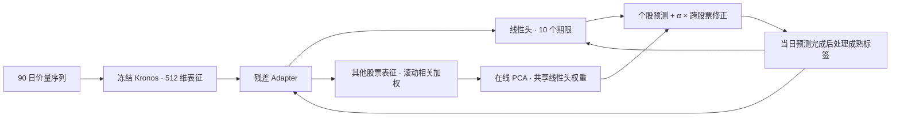

# Stock Forecast

基于冻结 Kronos 的日频股票预测实验。模型在个股残差 Adapter 和持续学习线性头的基础上，聚合当日其他股票的 Adapter 表征，并通过在线 PCA 生成跨股票收益修正。输入为最近 90 个交易日，输出为未来 1 至 10 个交易日相对信号日收盘价的累计收益。



## 当前结果

2026-11-21 的实验比较同市场、同面板、同种子的 Adapter 持续学习基线与 60 日和 120 日跨股票修正。下表展示 60 日窗口、α = 0.025 的第 10 日 Endpoint 结果，数值为种子 100、101、102 的均值。

| 市场 | 测试日 | 基线 RankIC | 修正 RankIC | 基线净累计收益 | 修正净累计收益 |
| --- | ---: | ---: | ---: | ---: | ---: |
| CSI300 | 226 | 0.044606 | 0.044725 | 64.79% | 65.77% |
| Nasdaq-100 | 235 | 0.031280 | 0.031300 | 44.03% | 45.18% |
| S&P 500 | 235 | 0.006962 | 0.006945 | 28.51% | 28.51% |

CSI300 的 Endpoint RankIC 增量约为 0.000119，10 日配对区块 bootstrap 的 95% 区间约为 [0.000006, 0.000249]。三个市场的 Endpoint 净累计收益增量区间均跨零。美股将 α 提到 1 后，两个市场的 Endpoint RankIC 和净累计收益均值均下降。完整的 Endpoint、Path、分种子结果和区间见 [实验报告](results/README.md)。

## 快速开始

使用 Python 3.12。从项目根目录执行以下命令。美股归档回放需要支持 CUDA 的 PyTorch，CSI300 回放和单元测试可使用 CPU。

```bash
python -m venv .venv
# Windows PowerShell: .\.venv\Scripts\Activate.ps1
# Linux/macOS: source .venv/bin/activate
python -m pip install -r requirements.txt
python -m pytest -q
python scripts/experiments/run_peer_pca_60d_csi300.py --help
python scripts/experiments/run_peer_pca_60d_us.py --help
```

完整回放使用已有的 Kronos 表征、Adapter 检查点、监督日志和 120 日对照归档。输入契约和运行命令见 [复现指南](docs/reproduction.md)。

## 项目导航

| 内容 | 入口 |
| --- | --- |
| 架构、公式和在线更新顺序 | [模型说明](docs/method.md) |
| 测试窗口、输入文件和命令 | [复现指南](docs/reproduction.md)、[数据契约](data/README.md) |
| 三市场评估和审计摘要 | [实验结果](results/README.md) |
| 跨股票关系、Kronos 和在线适应阅读笔记 | [paper_reading](paper_reading/README.md) |
| 摘要、方法草稿和论断依据 | [paper_writing](paper_writing/README.md) |
| 运行器、评估与测试 | [scripts](scripts/experiments)、[src](src/kronos_continual)、[tests](tests) |
| 引用与改动说明 | [CITATION.cff](CITATION.cff)、[CONTRIBUTING.md](CONTRIBUTING.md) |

本分支是现有 [kronos-stock-forecast 项目](https://github.com/Zane-wzn/kronos-stock-forecast)的聚焦研究快照。仓库原有研究授权以原项目为准。Kronos 权重和行情数据适用各自的条款。
